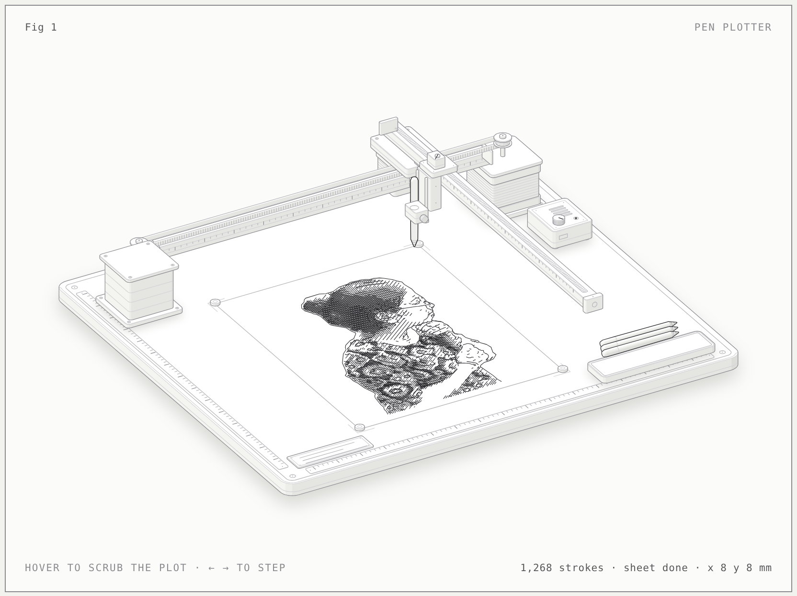
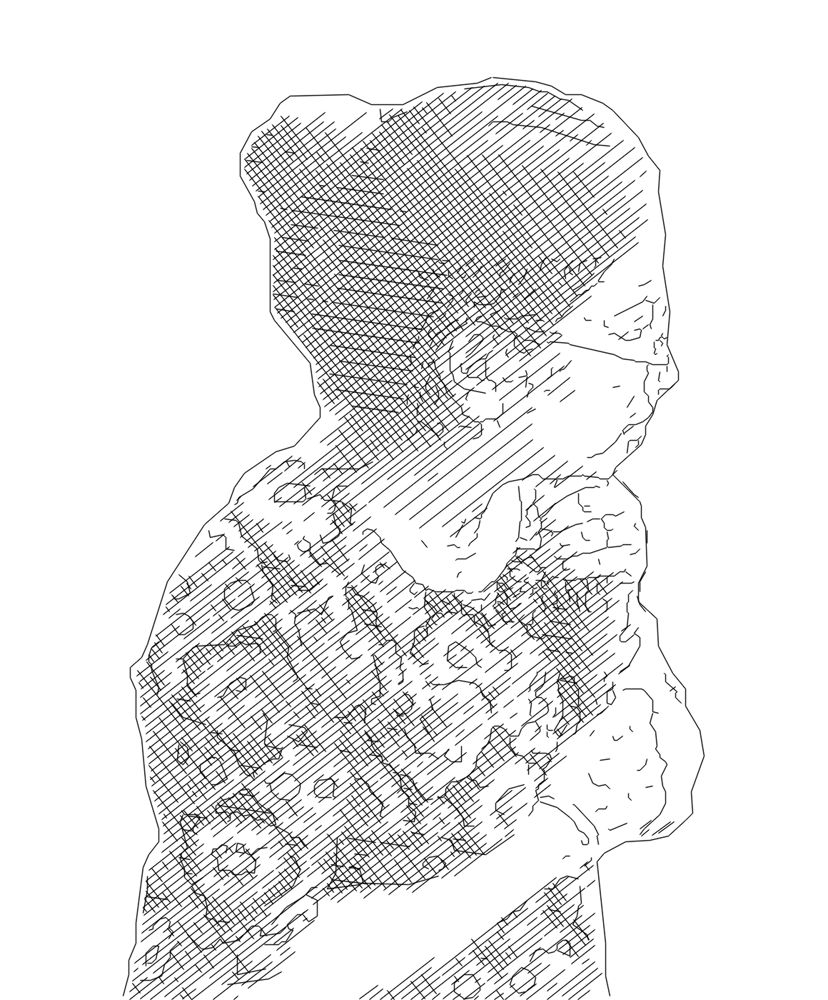

# Portrait plotter

An isometric pen plotter that draws an ink portrait, stroke by stroke, plus the pipeline that turned a photograph into those strokes and an SVG you can send to a real plotter.



Open `site/index.html` in a browser. The machine draws the sheet on a loop; hover across the card to scrub through the plot, or use the arrow keys. The readout shows the stroke number, which pass it belongs to, whether the pen is up or down, and the pen position in millimetres.

## How the portrait is made

The photo becomes 1,268 strokes, about 15 m of ink:

1. **Cut-out** (`trace/seg.py`). GrabCut separates the sitter from the garden behind her. It lost the nose, lips and chin to the leaves, so the face profile is traced by hand and written back into the mask.
2. **Lines** (`trace/ink.py`). The outline comes from the mask. Contour lines come from a difference-of-Gaussians edge map, tuned finer on the face and hands than on the printed kurta, then thinned to one pixel and walked into polylines.
3. **Tone.** Five hatching passes at three angles. Each pass draws only where the photo is darker than its threshold, so shadows collect more crossing lines, the way an engraver builds tone.
4. **Order.** Contour lines are sorted nearest-neighbour; each hatch pass runs back and forth like mowing a lawn, so pen-up travel stays short.



The strokes are stored in `data/portrait.json` as polylines in traced-pixel units, with each stroke's pass in `kinds`.

## Plotting it for real

```sh
python export/to_svg.py                   # A4 portrait -> export/portrait.svg
python export/to_svg.py --paper 148x210 --scale 0.2   # smaller, on A5
```

The SVG is in millimetres (164 × 197 mm by default), with one Inkscape layer per pass in plotting order, so you can plot the contours first and stop or swap pens between passes. It works with the AxiDraw or iDraw Inkscape extensions, or with [vpype](https://github.com/abey79/vpype):

```sh
vpype read export/portrait.svg linemerge linesimplify reloop linesort write plot.svg
```

Expect roughly 10–20 minutes on a hobby plotter. Use a 0.3–0.5 mm fineliner; the hatch lines in the darkest areas sit about 1.3 mm apart.

## Rebuilding

```sh
node plotter/build.mjs           # site/index.html (light)
node plotter/build.mjs --dark    # site/index-dark.html
```

To re-trace from a photo (the original is not in this repo):

```sh
pip install -r requirements.txt
python trace/seg.py path/to/photo.jpg
python trace/ink.py path/to/photo.jpg
```

The crop box, GrabCut rectangle, face and hand regions and hand-traced profile in those scripts are tuned to the original photo; a new photo needs them adjusted.

## Credits

The isometric drawing kit in `vendor/anatomy` is from the Anatomy skill, MIT licensed (see `vendor/anatomy/LICENSE`).
